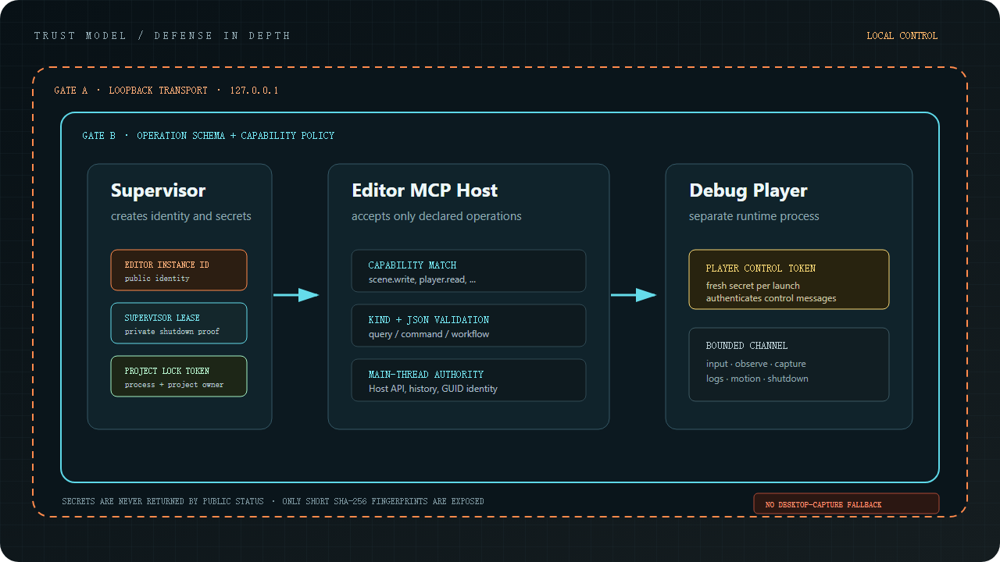

# Notes

This is a local development hook, not a public server. It only binds to localhost.

Every call is checked against the operation schema and `ProjectSettings/mcp_capabilities.json`. Read the schema's `reversible` and `side_effects` fields before editing. Commands that declare undo support use the Editor's normal undo stack; saving or reloading files, checkpoint restoration and Player builds are not general undo transactions.

Screenshots come from the engine's Scene, Game, or composed Editor render targets, never from the desktop.

A few short-lived tokens exist for shutting down the Editor, locking the current project, and talking to a Debug Player. Status calls never return the secret itself.
HTTP requests require a per-user bearer credential. The credential lives under the user state directory, never the project. Standard IDE configurations use a stdio proxy which reads the current credential automatically; direct HTTP clients need authorization. Host checks apply to every route and browser Origin headers are rejected. `/health` is a credential-free readiness probe and exposes no project or owner state.

Authenticated development access is trusted access, not a sandbox. Writing project Python or building a Player can execute code with the Editor user's privileges. Capability profiles select the intended workflow; they do not isolate code from that user.
